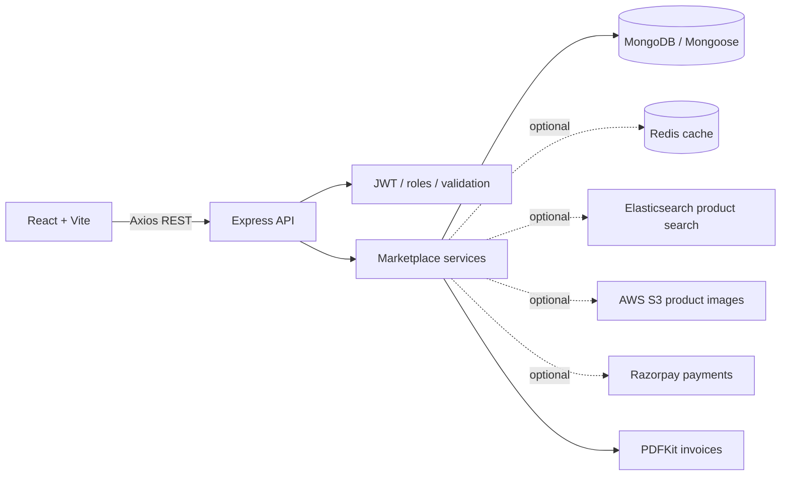

# Multi-Vendor-E-Commerce-Marketplace

MarketHub is a learning-focused multi-vendor marketplace built with a separate React/Vite frontend and Express/Mongoose backend. Customers can browse products, manage a cart, check out across stores, pay through an optional Razorpay integration, review delivered purchases, and download invoices. Vendors apply for approval and manage their catalog and order shipments. Admin endpoints support vendor/customer moderation, categories, commissions, and payments.

This is a functional development project, not a production-ready Amazon replacement. Run it with a MongoDB replica set (MongoDB Atlas works) for transactional checkout. Optional external services are only active when correctly configured. No service credentials are included.

## Architecture

See [architecture](./docs/architecture.md), [database schema](./docs/database.md), [API documentation](./docs/api.md), [setup](./docs/setup.md), and [testing](./docs/testing.md).

## Technology

- Frontend: React, Vite, React Router, Tailwind CSS, Redux Toolkit, Axios.
- Backend: Node.js, Express, Mongoose, MongoDB, JWT, bcrypt, Zod.
- Optional integrations: Redis, Elasticsearch, AWS S3, Razorpay test mode, PDFKit.

## Prerequisites

- Node.js 20+ and npm.
- MongoDB Atlas or another MongoDB replica-set deployment for checkout transactions.
- Git is recommended for version control.

## Setup

1. Copy `backend/.env.example` to `backend/.env`; set `MONGODB_URI` to your own MongoDB connection string and `JWT_SECRET` to a random secret of at least 32 characters. Copy `frontend/.env.example` to `frontend/.env`.
2. From the project root, run `npm install`.
3. Optionally add Razorpay test credentials and configure other services as described in [setup](./docs/setup.md). Do not put backend secrets in `frontend/.env`.
4. Run `npm run dev`, then open `http://localhost:5173`.

The backend attempts MongoDB before it starts listening. If the database cannot connect, the API can still start in degraded mode so `GET http://localhost:5000/api/health` reports HTTP 503 with a disconnected database status. No Atlas connection has been verified unless you provide credentials and test it.

## Commands

| Command | Purpose |
| --- | --- |
| `npm install` | Install frontend and backend workspace dependencies |
| `npm run dev` | Run API and frontend together |
| `npm run dev -w backend` | Run only the API |
| `npm run dev -w frontend` | Run only the frontend |
| `npm run build` | Create the frontend production bundle |
| `npm test` | Run backend unit tests |
| `npm run seed` | Add sample categories and browseable products |
| `npm run provision-admin -w backend` | Create an admin using `ADMIN_*` values from `backend/.env` |
| `npm run reindex -w backend` | Rebuild Elasticsearch product index when configured |

Seeded sample products are browseable but are not attached to a sellable vendor unless explicit `SEED_VENDOR_*` values are set. Never reuse production credentials for seed accounts.

## Implemented workflows

- Customer and vendor registration, login, JWT authentication, and role-based API access.
- Vendor applications, admin approval, vendor-owned product CRUD, image upload endpoint, order and sales views.
- Product catalog search, categories, filters, sorting, and pagination.
- MongoDB-backed cart and addresses.
- Server-priced multi-vendor checkout with a parent order, vendor suborders, commission ledger, and stock reservation in a transaction.
- Razorpay order creation, provider-side capture confirmation, HMAC verification, and signed webhook support. No automatic split settlement or vendor payout is claimed.
- Coupon validation/admin endpoints, review moderation and verified-delivery reviews, notifications, and PDF invoices.
- Admin dashboards and vendor/customer/category/payment/commission management endpoints.

## Integration status and caveats

- MongoDB credentials are not supplied; Atlas connectivity remains to be configured and tested by the developer.
- Redis and Elasticsearch are optional. Redis is currently an adapter/connection check; customer carts remain MongoDB-backed. Elasticsearch search falls back to MongoDB.
- S3 upload requires bucket configuration and an access strategy for serving images. Uploaded objects are private by default; configure a CloudFront/public asset URL policy before relying on direct URLs in a production storefront.
- Razorpay requires test credentials and a configured webhook secret. Orders remain pending until provider verification; vendor settlement is tracked separately and is not automated.
- Checkout transactions need MongoDB replica-set support. Tax is not calculated; shipping and commission are configurable. Refund/dispute processing and automatic settlement are not implemented.

## Security

- Public registration cannot set an admin role. Use the protected provisioning script for the first admin.
- Passwords are hashed; API secrets belong only in `backend/.env`.
- Authenticated APIs enforce roles and vendor ownership. Prices and commissions are computed server-side.
- Helmet, CORS allowlisting, request validation, auth rate limiting, and payment signature checks are enabled.
- `.env` files and local uploads are ignored by Git. Review the specific integration setup before deployment.

## More information

- [Local and deployment setup](./docs/setup.md)
- [Testing and known limits](./docs/testing.md)
- [API endpoints](./docs/api.md)
- [Data models](./docs/database.md)
- [Architecture](./docs/architecture.md)
- [Development status checklist](./DEVELOPMENT_STATUS.md)
