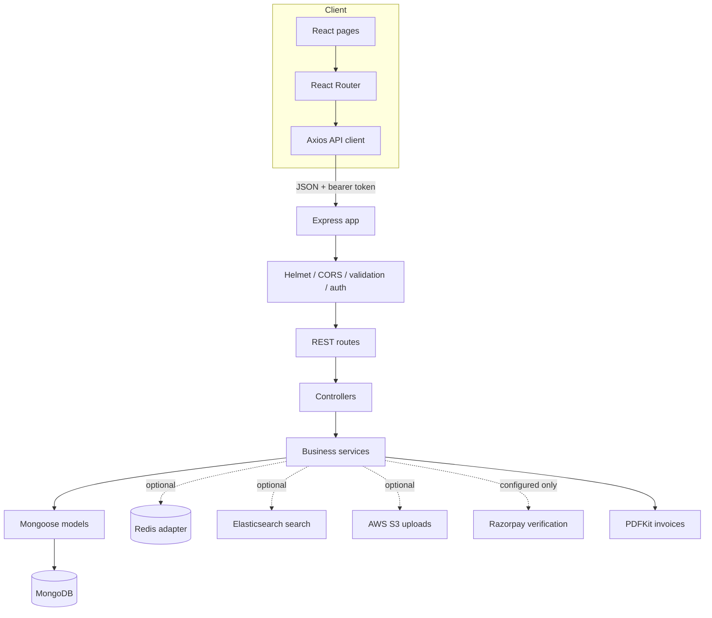

# Architecture

## System shape

The browser talks only to the Express REST API. The API owns validation, authentication, pricing, stock changes, and order state. MongoDB stores marketplace records through Mongoose. Optional infrastructure is isolated behind backend services and degrades explicitly when it is unavailable.

## Folder responsibilities

### `backend/src`

- `config/`: environment parsing and database connection.
- `controllers/`: HTTP request/response handling.
- `middleware/`: authentication, roles, validation, and centralized errors.
- `models/`: Mongoose schemas and indexes.
- `routes/`: endpoint definitions.
- `services/`: business operations shared across controllers.
- `utils/`: async wrappers and application errors.
- `validators/`: request schemas.

### `frontend/src`

- `services/`: Axios client and API calls.
- `components/`: reusable UI.
- `context/`: session state.
- `pages/`: route-level screens.

## Important design constraints

- A public request can create only a customer account. Elevated roles are assigned through protected administrative workflows.
- Money and stock are authoritative only when read and calculated on the server.
- Payment confirmation must come from verified provider signatures/webhooks, not a browser redirect.
- Vendor payouts and platform commission accounting are tracked separately; this application does not claim automatic split settlement.
- Database transactions require MongoDB replica set support. Checkout must report/handle unsupported deployment topology rather than silently pretending to be transactional.
- Redis is not currently used for cart persistence; carts are stored in MongoDB.
- S3 objects are private by default. Configure a CDN or an explicit asset-access policy before using S3 URLs for public product images.
